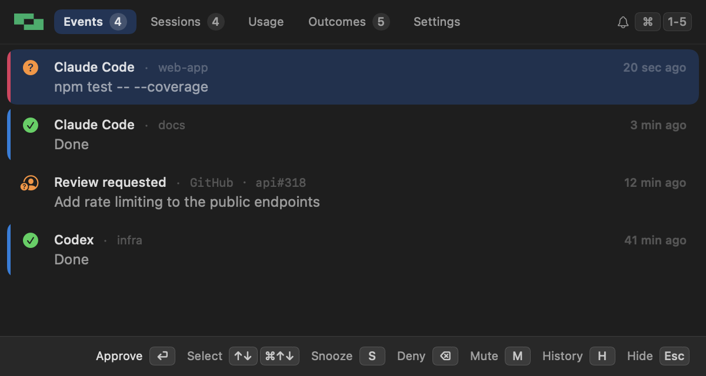
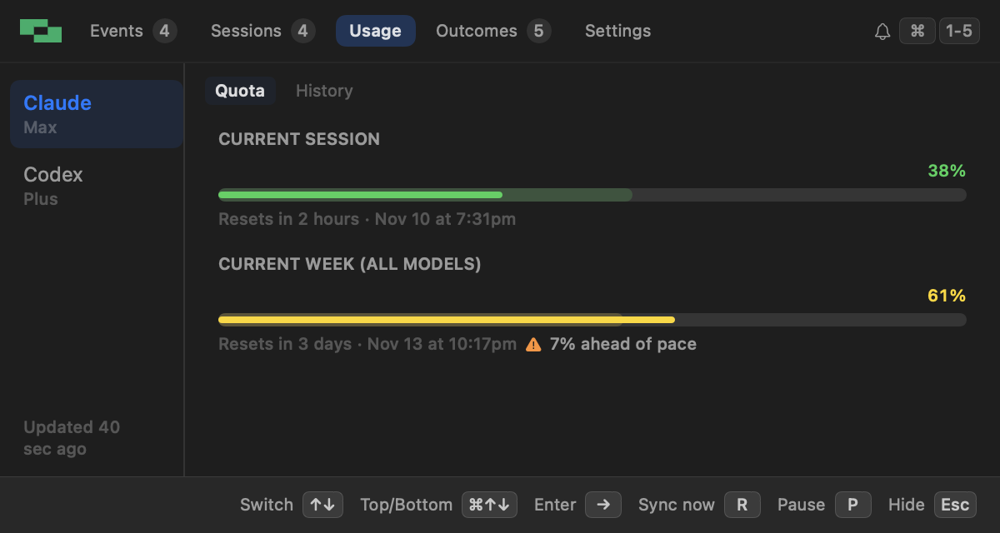
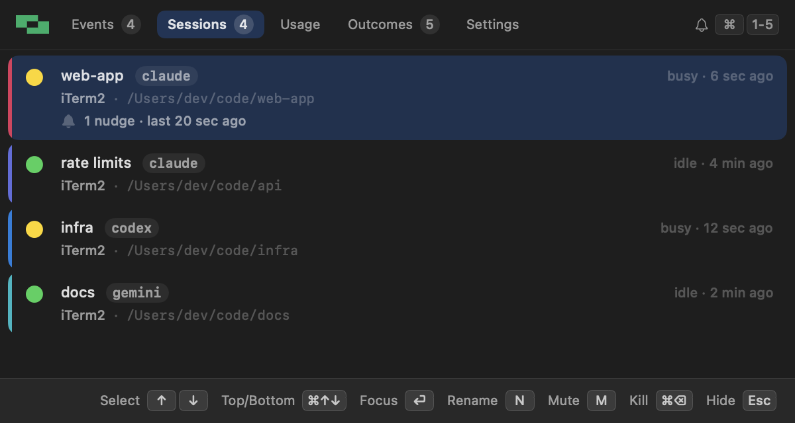
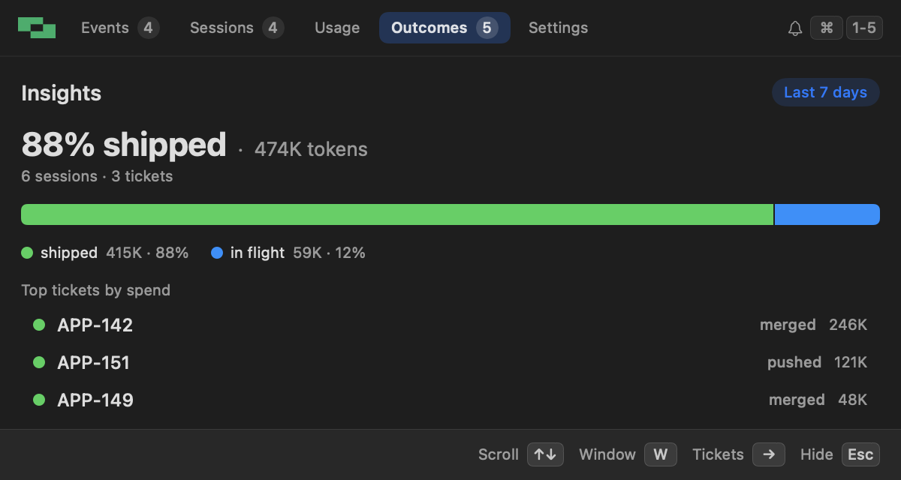
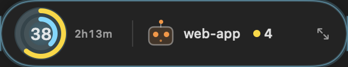

<div align="center">
  
  <h1>StackNudge</h1>
  <p><strong>Notifications for AI coding agents.</strong></p>
  <p>Get a banner + sound when your agent finishes a task or pauses for your approval — step away without missing a beat.</p>
  <p>
    <a href="https://github.com/StackOneHQ/stack-nudge/releases/latest"></a>
    <a href="https://github.com/StackOneHQ/stack-nudge/actions/workflows/ci.yml"></a>
    <a href="LICENSE"></a>
    
  </p>
  <p>
    Maintained by <a href="https://www.stackone.com/">StackOne</a> ·
    <a href="https://github.com/StackOneHQ">@StackOneHQ</a>
  </p>
</div>

---

<p align="center">
  
  
</p>

StackNudge is a macOS menu-bar app that tells you when an AI coding agent finishes a turn or stops to ask permission, and lets you answer from the keyboard:

- **Banners, sound and voice** when an agent is done or waiting. Click one, or press `⏎` in the panel, to jump to the exact terminal or editor window. Claude Code and Codex prompts can be approved right from the panel.
- **A keyboard-driven panel** (`⌘⌥N`) with your recent nudges, every running agent session, your subscription quota, and what your agent work actually shipped.
- **Reminders** for prompts you missed, an optional **Slack DM** when you're away from the Mac, and a timed **mute** when you need quiet.
- **Extensions** that add their own tabs and settings pages.

## Supports

| Agent | Approve from the panel |
|-------|--------|
| Claude Code | ✅ |
| Codex | ✅ |
| Cursor | — (turn ends only) |
| Gemini CLI | banner only † |
| Antigravity CLI | banner only † |
| pi | — (turn ends only) |
| Any hooks-capable agent | banner only, once you point it at `notify.sh` ([manual setup](docs/setup.md#manual-setup)) |

† These agents report a permission prompt but can't take an answer from outside, so you still click Allow / Deny in the agent's own terminal.

**Platforms:** macOS gets the full app. Linux (PulseAudio / ALSA / libnotify) and Windows (Git Bash / WSL) get sound and basic notifications through `notify.sh` only.

## Install

### macOS

Download the latest release from [GitHub Releases](https://github.com/StackOneHQ/stack-nudge/releases/latest), pick the `.tar.gz` for your Mac (`arm64` for Apple Silicon, `x86_64` for Intel), expand it, and drag `StackNudge.app` into `~/Applications/`. Or with [`gh`](https://cli.github.com/):

```bash
ARCH=$(uname -m)
gh release download --repo StackOneHQ/stack-nudge --pattern "stack-nudge-*-macos-${ARCH}.tar.gz*"
shasum -a 256 -c stack-nudge-*-macos-${ARCH}.tar.gz.sha256
tar xzf stack-nudge-*-macos-${ARCH}.tar.gz
mv StackNudge.app ~/Applications/
open ~/Applications/StackNudge.app
```

On first launch a one-screen setup finds the agents you use (all of the above except pi, which `./install.sh` wires), wires their hooks, starts StackNudge at login, and walks you through the macOS permissions it needs. Everything ships inside the app, voice engine included; new releases install themselves from Settings.

### Linux / Windows, or from source

```bash
git clone https://github.com/StackOneHQ/stack-nudge.git
cd stack-nudge
./install.sh
```

The installer wires hooks for every agent it finds. On macOS it also builds and installs the app, which needs the Xcode Command Line Tools. Requires Python ≥ 3.10.

## The panel

Press `⌘⌥N` from anywhere. `⌘1`…`⌘9` or `⌘←` / `⌘→` switch tabs, `↑ ↓` and `⏎` do the rest, and `Esc` hides it. Every page's footer lists its keys.

| Tab | What's there |
|-----|--------------|
| **Events** | Finished turns and permission prompts, newest first. `⏎` approves or jumps to the agent, `S` snoozes, `M` mutes everything for a while, `H` opens the full history. |
| **Sessions** | Every running agent: busy or idle, its terminal tab, and for Claude Code how full its context is. `⏎` focuses it, `N` renames, `M` mutes just that session. |
| **Usage** | Claude, Codex, Antigravity and pi quota, with a warning when you're spending faster than the window resets, and alerts at a threshold you pick. |
| **Outcomes** | How much of your agents' token spend ended up shipped (pushed or merged), by ticket and by agent. |
| **Settings** | Everything above, plus voice, the floating widget, Slack and extensions. `⌘,` opens it. |

<p align="center">
  
  
</p>

When you're not using the panel, a floating widget stays on the desktop. New installs get the **companion**, an animated character whose pose follows your agents (busy, waiting on you, a quota running hot, muted) and that opens the panel when clicked. Or pick the **pill** in **Settings → Appearance → Floating widget**, which shows your quota, the reset countdown and your agents at a glance:

<p align="center">
  
</p>

The whole panel, key by key, is in **[docs/panel.md](docs/panel.md)**.

## Extensions

Extensions add a tab, a Settings page, or a small background service, and install from **Settings → Extensions → Browse extensions**. They run as you rather than in a sandbox, so only extensions reviewed in this repo are offered. To write one, see **[docs/extensions.md](docs/extensions.md)**.

## Configuration

Settings is the place to change things. Every choice is saved to `~/.stack-nudge/config`, a plain `KEY=value` file you can back up or script; tokens for Slack and GitHub live in the Keychain instead. There's no account, analytics or backend; [PRIVACY.md](PRIVACY.md) lists the few network calls it makes (update checks, and Slack, GitHub and extensions once you turn them on).

## More

- **[docs/notifications.md](docs/notifications.md)**: which hooks are wired, click-to-focus, how permission prompts and reminders behave, feed events from your own scripts, Slack, voice and sounds.
- **[docs/panel.md](docs/panel.md)**: every tab and key, the menu bar, Outcomes and GitHub linking.
- **[docs/setup.md](docs/setup.md)**: permissions, auto-update, uninstalling, wiring an agent by hand, and development.
- **[docs/extensions.md](docs/extensions.md)**: building and publishing extensions.

## Uninstall

**Settings → Actions → Uninstall StackNudge…** removes the hooks, the login items, `~/.stack-nudge/` and the app. Without the app, run `./uninstall.sh` from a clone. Details in [docs/setup.md](docs/setup.md#uninstall).

## Contributing

Issues and pull requests are welcome; see [CONTRIBUTING.md](CONTRIBUTING.md). `make dev` rebuilds and restarts the app on every save, and [docs/setup.md](docs/setup.md#development) has the rest.

## Terms of use

By using stack-nudge or its source code, you agree to the following:

- Use is governed by the [MIT License](LICENSE). The software is provided "as is", without warranty of any kind.
- Participation in the project (issues, pull requests, discussions) is subject to the [Code of Conduct](CODE_OF_CONDUCT.md).
- Suspected security vulnerabilities should be reported privately per [SECURITY.md](SECURITY.md), not via public issues.
- The project is maintained by [StackOne](https://www.stackone.com/); contributions remain under the licence the contributor submits them under (MIT unless otherwise noted).

## License

MIT — see [LICENSE](LICENSE) for the full text. Copyright © 2026 StackOne Technologies Ltd. and contributors.
